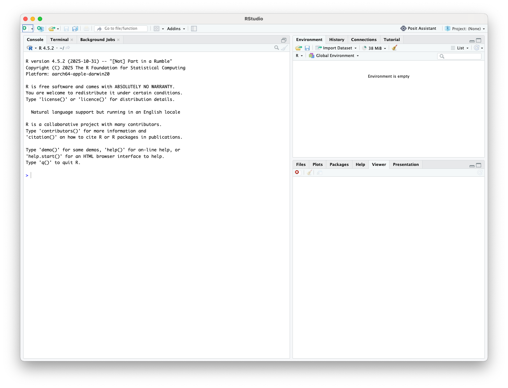
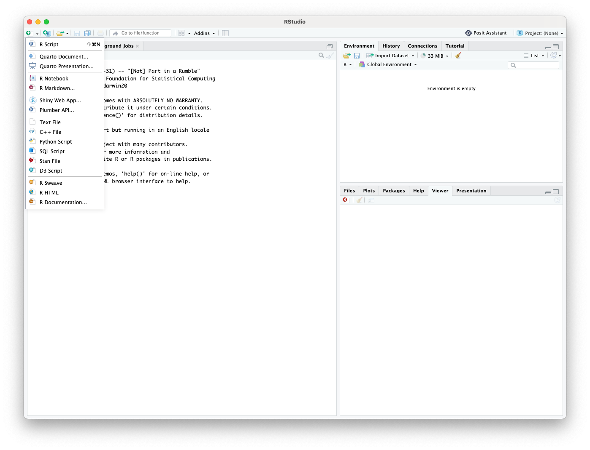
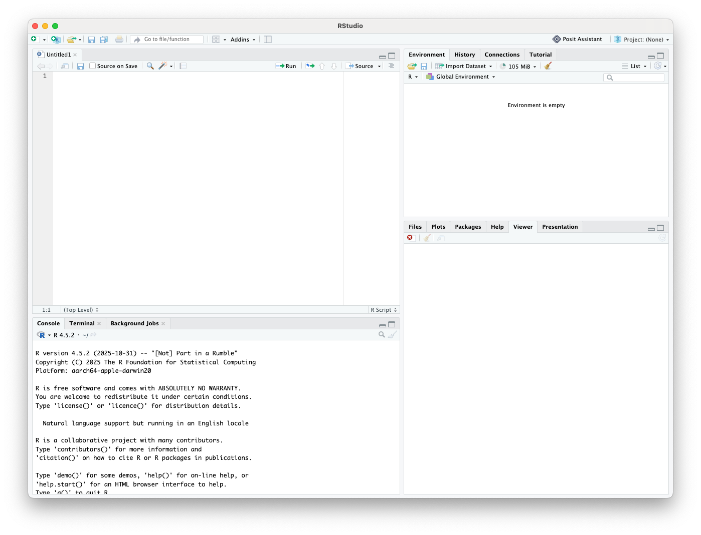

```{=html}
<style>
h1.title {
  font-size: 48px;

  text-align: center;
}
h4.author { 
  text-align: center;
}
body {
text-align: justify}
</style>
```


<center></center>

```{r setup, include=FALSE}
knitr::opts_chunk$set(echo = TRUE, fig.pos= "H")
library(tidyverse)
library(kableExtra)
```


# Introduction 

In this session you will be introduced to the practical side of pharmacokinetics - with a data workshop. You will be introduced to '`R`': a language and environment for statistical computing and its partner programme 'RStudio', which provides a handy user interface for '`R`'.

We will use '`R`' to undertake visualisation of pharmacokinetic data using the '`R`' package '`ggplot2`'. We will use `R` to summarise some pharmacokinetic data to give us an important measure of exposure - the maximum drug concentration  ($C_{max}$).

This session has been designed to progress your knowledge of pharmacokinetics and give you an introduction into the world of using code to analyse, visualise and communicate with data - skills that the drug development industry consistently tell us they need from graduates. Although we are using `R` for pharmacokinetic data, the software can be used in any field of data analysis. Similarly, if you are already used to coding with another language (like `Python`), feel free to explore the data from this session using whichever language you prefer.

## Learning outcomes  

  
* Define the important pharmacokinetic measures of drug exposure $C_{max}$, $T_{max}$, and $AUC$
* Access `R` and `RStudio` onto your own computer or a University PC
* Understand the different windows in the `RStudio` desktop
* Make and save an  `R` script
* Undertake some basic calculations using  `R`
* Import a .csv data file into  `R` 
* View a data frame
* Describe the difference between 'long' and 'wide' data formats and which is used for pharmacokinetic modelling
* Download a package to your  `R library` 
* Call a  `package` from the  `R library`
* Plot some pharmacokinetic data using the  `R` package  `ggplot2`
  + Change the aesthetics of plots 
  + Use  `ggplot2` to transform axes and plot individual data using  `facet_wrap()`
* Use  `R` to undertake basic, descriptive (non-compartmental) analysis of some pharmacokinetic data to 
    + Estimate $C_{max}$


This document is designed to provide you with notes of the session and be a handy resource when you come to revision. There are examples of code and the corresponding output from `R` as we go along.  

# Important pharmacokinetic measures of drug exposure 

## $C_{max}$, $T_{max}$, and $AUC$ definitions {.tabset .tabset-fade}

As we go through the pharmacokinetics learning on this course, you will become increasingly familiar with some terms that are used to quantitatively describe drug exposure. Three key measures are:

* $C_{max}$ - the maximum plasma concentration observed after a dose of drug is administered
* $T_{max}$ - the time at which the maximum plasma concentration of a drug is observed
* $AUC$ - the area under the plasma time-concentration curve


### Task {-}

Below is a time concentration plot. Identify $C_{max}$, $T_{max}$, and $AUC$.

``` {r pk-task,eval=TRUE,echo=FALSE, fig.cap='Time-concentration profile with some measures of exposure indicated'}


# 1. Generate simulated oral PK data (slower absorption)
time <- seq(0, 24, by = 0.1)
ka <- 0.4  
ke <- 0.2  
dose <- 1000
V <- 15
conc <- (dose * ka / (V * (ka - ke))) * (exp(-ke * time) - exp(-ka * time))

pk_data <- data.frame(time, conc)

# 2. Define the specific time period for the shaded AUC
auc_end_time <- 12
auc_data <- subset(pk_data, time >= 0 & time <= auc_end_time)

# 3. Build the clean plot
ggplot(pk_data, aes(x = time, y = conc)) +
  
  # Shade the partial AUC using greyscale
  #geom_ribbon(data = auc_data, aes(ymin = 0, ymax = conc), fill = "grey75") +
  
  # Plot the main curve
  geom_line(linewidth = 1, color = "black") +
  
  theme_classic(base_size = 12) +
  labs(
       x = "Time (hours)",
       y = "Concentration (mg/L)") +
  
  # Snap the AUC shading to the bottom axis
  scale_y_continuous(expand = expansion(mult = c(0, 0.1))) +
  
  # Standardize the x-axis breaks
  scale_x_continuous(expand = expansion(mult = c(0, 0.05)),
                     breaks = seq(0, 24, by = 6))
```


### Solution {-}

Below is a time concentration plot. $C_{max}$, $T_{max}$, and $AUC$ are indicated.


``` {r pk-curve,eval=TRUE,echo=FALSE, fig.cap='Time-concentration profile with some measures of exposure indicated'}

library(ggplot2)
library(dplyr)

# 1. Generate simulated oral PK data with SLOWER absorption
time <- seq(0, 24, by = 0.1)
ka <- 0.4  # Decreased from 1.2 to 0.4 for slower absorption
ke <- 0.2  
dose <- 1000
V <- 15
conc <- (dose * ka / (V * (ka - ke))) * (exp(-ke * time) - exp(-ka * time))

pk_data <- data.frame(time, conc)

# 2. Extract Cmax and Tmax
cmax <- max(pk_data$conc)
tmax <- pk_data$time[which.max(pk_data$conc)]

# 3. Define the specific time period for the AUC
auc_end_time <- 12
auc_data <- subset(pk_data, time >= 0 & time <= auc_end_time)

# 4. Build the plot
ggplot(pk_data, aes(x = time, y = conc)) +
  
  # Shade the partial AUC using greyscale
  geom_ribbon(data = auc_data, aes(ymin = 0, ymax = conc), fill = "grey75") +
  
  # Plot the main curve
  geom_line(linewidth = 1, color = "black") +
  
  # Draw singular dashed lines
  annotate("segment", x = 0, xend = tmax, y = cmax, yend = cmax, linetype = "dashed", color = "black") +
  annotate("segment", x = tmax, xend = tmax, y = 0, yend = cmax, linetype = "dashed", color = "black") +
  
  # Mark the intersection
  annotate("point", x = tmax, y = cmax, color = "black", size = 3) +
  
  # Add text labels using parse = TRUE to render mathematical subscripts
  annotate("text", x = tmax + 0.5, y = cmax+ 0.5, label = "bold(C[max])", parse = TRUE, color = "black", hjust = 0, size = 5) +
  annotate("text", x = tmax + 0.5, y = cmax * 0.05, label = "bold(T[max])", parse = TRUE, color = "black", hjust = 0, size = 5) +
  annotate("text", x = auc_end_time -5, y = cmax / 3, label = "bold(AUC[0-12])", parse = TRUE, color = "black", size = 5) +
  
  theme_classic(base_size = 12) +
  labs(
       x = "Time (hours)",
       y = "Concentration (mg/L)") +
  
  # Snap the AUC shading to the bottom axis
  scale_y_continuous(expand = expansion(mult = c(0, 0.1))) +
  
  # Inject the exact Tmax value into the x-axis breaks
  scale_x_continuous(expand = expansion(mult = c(0, 0.05)),
                     breaks = sort(unique(c(seq(0, 24, by = 6), round(tmax, 1)))))

```

Note that in \@ref(fig:pk-curve) the $AUC$ is referenced to a specific time. Here I have shown $AUC_{0-12}$ hours. You might have chosen $AUC_{0-24}$. Common time periods include a dosing interval and in some circumstances an estimate of total exposure to a single dose of a drug, which comes with the notation $AUC_{0-\infty}$.

### IV and oral plots compared {-}

```{r pk-curve-comparison, eval=TRUE, echo=FALSE, fig.cap='Time-concentration profiles with measures of exposure indicated for (a) Intravenous bolus and (b) Oral administration.', fig.width=10, fig.height=4.5, fig.align='center', warning=FALSE, message=FALSE}

library(ggplot2)
library(dplyr)
library(patchwork) # The modern replacement for fig.subcap

# --- GLOBAL PARAMETERS ---
time <- seq(0, 24, by = 0.1)
dose <- 1000
V <- 15
ke <- 0.2  
ka <- 0.4  
auc_end_time <- 12

# ==========================================
# 1. INTRAVENOUS (IV) BOLUS PLOT
# ==========================================
conc_iv <- (dose / V) * exp(-ke * time)
iv_data <- data.frame(time, conc = conc_iv)

cmax_iv <- max(iv_data$conc)
tmax_iv <- iv_data$time[which.max(iv_data$conc)] 
auc_iv_data <- subset(iv_data, time >= 0 & time <= auc_end_time)

plot_iv <- ggplot(iv_data, aes(x = time, y = conc)) +
  geom_ribbon(data = auc_iv_data, aes(ymin = 0, ymax = conc), fill = "grey75") +
  geom_line(linewidth = 1, color = "black") +
  annotate("point", x = tmax_iv, y = cmax_iv, color = "black", size = 3) +
  annotate("text", x = 0.5, y = cmax_iv, label = "bold(C[max])", parse = TRUE, color = "black", hjust = 0, size = 5) +
  annotate("text", x = 0.5, y = cmax_iv * 0.1, label = "bold(T[max])", parse = TRUE, color = "black", hjust = 0, size = 5) +
  annotate("text", x = auc_end_time - 8, y = cmax_iv / 3, label = "bold(AUC[0-12])", parse = TRUE, color = "black", size = 5) +
  theme_classic(base_size = 12) +
  labs(x = "Time (hours)", y = "Concentration (mg/L)") +
  scale_y_continuous(expand = expansion(mult = c(0, 0.1)), limits = c(0, 70)) +
  scale_x_continuous(expand = expansion(mult = c(0, 0.05)), breaks = seq(0, 24, by = 6))

# ==========================================
# 2. ORAL ADMINISTRATION PLOT
# ==========================================
conc_oral <- (dose * ka / (V * (ka - ke))) * (exp(-ke * time) - exp(-ka * time))
oral_data <- data.frame(time, conc = conc_oral)

cmax_oral <- max(oral_data$conc)
tmax_oral <- oral_data$time[which.max(oral_data$conc)]
auc_oral_data <- subset(oral_data, time >= 0 & time <= auc_end_time)

plot_oral <- ggplot(oral_data, aes(x = time, y = conc)) +
  geom_ribbon(data = auc_oral_data, aes(ymin = 0, ymax = conc), fill = "grey75") +
  geom_line(linewidth = 1, color = "black") +
  annotate("segment", x = 0, xend = tmax_oral, y = cmax_oral, yend = cmax_oral, linetype = "dashed", color = "black") +
  annotate("segment", x = tmax_oral, xend = tmax_oral, y = 0, yend = cmax_oral, linetype = "dashed", color = "black") +
  annotate("point", x = tmax_oral, y = cmax_oral, color = "black", size = 3) +
  annotate("text", x = tmax_oral + 0.5, y = cmax_oral + 2, label = "bold(C[max])", parse = TRUE, color = "black", hjust = 0, size = 5) +
  annotate("text", x = tmax_oral + 0.5, y = cmax_oral * 0.1, label = "bold(T[max])", parse = TRUE, color = "black", hjust = 0, size = 5) +
  annotate("text", x = auc_end_time - 5, y = cmax_oral / 3, label = "bold(AUC[0-12])", parse = TRUE, color = "black", size = 5) +
  theme_classic(base_size = 12) +
  labs(x = "Time (hours)", y = "Concentration (mg/L)") +
  scale_y_continuous(expand = expansion(mult = c(0, 0.1)), limits = c(0, 70)) +
  scale_x_continuous(expand = expansion(mult = c(0, 0.05)),
                     breaks = sort(unique(c(seq(0, 24, by = 6), round(tmax_oral, 1)))))

# ==========================================
# 3. STITCH AND AUTO-TAG
# ==========================================
# This one line replaces fig.subcap, out.width, fig.show, and fig.ncol
plot_iv + plot_oral + plot_annotation(tag_levels = 'a')
```


# Introducing `R` and `RStudio`

## Accessing `R` and `RStudio` on a University computer 

The two key tools for this session will be `R` and `RStudio`. These are free, open source pieces of software. They are both available on the University computers, but you may choose to download them onto your personal laptop or home computer.

'`R`' is a language and environment for statistical computing. `R` is very powerful but it was not designed with the 'everyday' user in mind. '`RStudio`' is a user interface that makes using '`R`' far easier. You can think of the relationship between '`R`' and '`RStudio`' as similar to the relationship between the lines of code (`R`) running your computer that you do not see behind the user interface you use - MS Windows (`RStudio`) or as the relationship between equipment for an experiment (`R`) and the laboratory that houses it (`RStudio`). 

When you are using a University computer, you need to access `RStudio` via the University servers.

If you are *onsite*, you can use <https://shms-stats4.city.ac.uk/>. You will then need to login with your 'city.ac.uk' email address and password. 

If you are trying to access *offsite*, you cannot directly go to this web address. First you need to login to the virtual desktop. There are some instructions on how to do this [here](https://studenthub.citystgeorges.ac.uk/student-support-services/it-services/city-virtual-desktop#accordion858419-how-do-i-access-cvd?). 

A video with me showing you this (captioned) is below.

<video width="100%" controls>
  <source src="Accessing R_default.mp4" type="video/mp4">
  <track src="captions.vtt" kind="captions" srclang="en" label="English" default>
</video>

## Introducting the `RStudio` environment

When you first open `RStudio`, you will likely see *three* windows (or 'panes') as shown in Figure \@ref(fig:rstudio-3panes).

```{r rstudio-3panes, echo=FALSE, fig.cap="The default RStudio layout with three panes.", out.width="100%", fig.align='center'}


```

Let's open the fourth and most important window.

Go to the top menu and click **File > New File > R Script** (Figure \@ref(fig:rstudio-dropdown)). Alternatively, you can click the white paper icon with the green plus in the top left corner.

```{r rstudio-dropdown, echo=FALSE, fig.cap="Opening a new R script from the File menu.", out.width="100%", fig.align='center'}


```


Your screen is now divided into four distinct panels (Figure \@ref(fig:rstudio-4panes)). It can look a bit overwhelming at first. If it helps, you can think of it like a scientific laboratory:

```{r rstudio-4panes, echo=FALSE, fig.cap="The four main panes of the RStudio desktop interface, after opening a new R Script.", out.width="100%", fig.align='center'}
# Note: Ensure you have an annotated screenshot named 'rstudio_4panes.png' saved in your working directory.


```

* **Top-left: script editor (experiment plan).** This is the window you just opened. It is where you will spend most of your time typing, editing, and saving your code. Code written here isn't run until you tell it to (by clicking 'Run' or using `ctrl+enter` [`cmd+enter` on a Mac]). Just like an experimental plan, it gives exact, step-by-step instructions that you can write and then save, so your experiment can be perfectly reproduced later.
* **Bottom-left: the console (your lab bench).** This is where the code actually runs—the place where your 'experiment' happens. When you execute a line from your script, it is sent down here. You will see your immediate results (and any error messages) appear in this window. You can type code directly into the console and hit enter, but just like doing an experiment without writing it down, it won't be saved for next time (so you won't be able to easily repeat it).
* **Top-right: the environment (samples and reagents rack).** When you load a dataset (today it will be pharmacokinetic data) or calculate and save a new value, it will appear here. It shows you every dataset, variable, and object you currently have available in your computer's active memory, ready to be used in your analysis. A bit like getting all the reagents ready and then having a rack to store the final elements of your experiment.
* **Bottom-right: files, plots, packages, and help (the lab toolkit and monitor).** This is a multi-purpose window. When we start visualising our pharmacokinetic data, the graphs will pop up in the 'Plots' tab like a read-out on a lab monitor. If you need to look up how a specific function works, the equipment manual will appear in the 'Help' tab.


## Some basics in `R` {.tabset .tabset-fade}

Try doing some simple maths and running the code by clicking '`Run`' or pressing `ctrl+enter` (`cmd+enter` if using a Mac).
<br>

``` {r,eval=TRUE, tidy=FALSE }
  
#Some example script
3+4 #simple addition
3*26 #multiplication
log(2) #logarithm

#note that I can make comments after a '#' that are ignored when I run lines of code

```
<br>

We can store items for later use. We can even put these together for a table. 

<br>


``` {r,eval=TRUE,  tidy=FALSE}
a<-seq(3) # asks for a sequence of 3 numbers and stores it as the object 'a'
a #calls the stored object 'a'
3*a # multiply all elements of 'a' by 3
mon<- c("JAN","FEB","MAR")
CAL<-data.frame(mon,a)
CAL #show 'CAL' data frame in R console.
```


### Some basic tasks {.tabset .tabset-fade}

#### Task {-}

Run through some basic calculations in R, store a vector of numbers and see if you can work out how to raise this to a power (e.g. square it).  

#### Solution {-}

``` {r,eval=TRUE,  tidy=FALSE}
b<- c(1,2,3,4) # stores a sequence of numbers (could also use b<- seq(4))
b # displays the numbers
b^3 # takes the cube of each number in the vector
```


## Saving your script 

The reason that you write all of your code in a 'script' is so that you can come back to it and re-use it (and/or edit it and/or copy bits of it for another project). 

To save an R-script, click on the save icon and save your file. **You must save is as a '.r' file**. For example 'year1session1.r'. Video of me doing this is below. 


A video with me showing you this is below.

<video width="100%" controls>
  <source src="save.mp4" type="video/mp4">
</video>

### More advanced - saving to a particular folder

If you want to create a new folder to store your scripts and work in. You can create a new folder and save you script there, but you should ideally then change the 'working directory' to the folder you created (so that anything else you save also goes there). 

You can either do that using the `setwd()` fuction or you can click 'Session' at the top of your screen then 'Set working directory' then 'to source file location'.

# Import and inspect some pharmacokinetic data

Let's get some PK data in to work with. I store all my data for learning on my GitHub pages. You can call this directly into `R` by running the following:

``` {r,eval=TRUE, results='hold', tidy=FALSE}
  
amox<- read.csv("https://raw.githubusercontent.com/dlonsdal/SGUL_PK_data/main/amoxicillin.csv")

```

## Inspect the data


If you click on the arrow by the amox object in your environment tab in RStudio, you will see that 'amox' contains 30 observations of 3 variables. An `ID`  variable, `time`  which is an integer value and `conc`  which contains numbers.  

This data set is a simulated pharmacokinetic experiment. Six participants were give an IV bolus (given very fast) of 1000 mg of amoxicillin and plasma concentrations were measured every 2 hours for 8 hours. 8 hours is a standard dosing interval for amoxicillin.    

There are some handy, built in `R` functions that you can use to have a look at the data.

```{r, eval=TRUE}
head(amox) # shows you the first 6 rows of the data frame
amox$ID # shows you the 'ID' column
summary(amox$ID) #summarises the ID column. 5 samples per participant

amox[15,] # looks at row 15
amox[,2] # looks at column 2
```
<br>
**Task:** Inspect the data yourself   

## Long and wide data  
### Long data  
You can also look at the data by clicking on 'amox' in the global environment. RStudio will show you the data table. What do you think about the format (Table \@ref(tab:long))?  
  
```{r long, echo=F}

knitr::kable(amox,booktabs = TRUE, caption='Original amoxicillin data')%>%
  kable_styling(latex_options = "striped")
```

It's pretty 'long' and unwieldy isnt it! Whilst this is not very easy for us to look at, believe it or not, it does make it quite easy for computer programs like `R` or `MS Excel` to analyse and manipulate. It's also the format data needs to be in to undertake pharmacokinetic analysis, so you will need to get used to formatting tables like this. In long form, each event for each ID has its own row. 

If you want to look at data in another way, for example by Time or by ID you can use `R` to do this to rearrange the data. 

### Wide data  

```{r time,echo=F}
amox %>%
  pivot_wider(names_from = time, values_from = conc)%>%
  knitr::kable(booktabs = TRUE,format='html', caption = "Amoxicillin data by sample time")%>%
  kable_styling()%>%
  add_header_above(c(" " = 1, "Time (hours)" = 5))
``` 

```{r ID,echo=F,results='asis'}
amox %>%
  pivot_wider(names_from = ID, values_from = conc)%>%
  knitr::kable(booktabs = TRUE,format='html', caption = "Amoxicillin data by ID number")%>%
  kable_styling()%>%
  add_header_above(c(" " = 1, "ID" = 6))
``` 

<br>

Tables \@ref(tab:time)&\@ref(tab:ID) are examples of data in wide format. They are perhaps a little more intuitive to read, but they are not so easy for a program like `R` to manipulate.  
  
## Checking data for anomalies  
One habit to get into when you are working with data is checking that the data for anomalies. This ensures that you have imported into `R` correctly and that there are no problems in the data base. In the setting of a study or trial, any anomalies you notice in a database should be raised as a 'data query'. 

There are lots of ways to check data. Where data frames are small, like  Tables \@ref(tab:time)&\@ref(tab:ID), you can inspect them visually and check that each participant has the right number of values and check that there are no obvious anomalies. Wide data frames may be easier to undertake visual inspections as you get one row per participant or sample time. Another common thing to do is to plot continuous variables and look for outliers, we will have a look at plotting data in the next section. `R` has some in built functions that can be helpful in checking data.  
  
### Using `R` to check for anomalies  
There are lots of ways you can use `R` to check data. Here are a few ideas.  

#### `summary()` function 

```{r}
summary(amox)
```

<bc>

Here, the three variables in the amoxicillin data set are summarised. It's a start, but we can do some more interesting things. To do this, we need to use one of the many available 'packages' that `R` has to offer. Packages are groups of functions (and some times datasets for you to use and learn with) that have been developed by the `R` community. Packages bring in new functions for us to use with our data. 

# Calling a package from the `R` library

`R` is a little bit like an empty laboratory. You can do _some_ useful things in it (like light a bunsen burner and heat something up) but if you want to do more advanced analytics you need to bring in some additional equipment (like an organ bath). In `R` these additional bits of kit are called 'packages'.

I suggest you start by using  `tidyverse`, which is actually a selection of useful packages. When you want to use something like this, you have to call it from the `R library` of packages with the function `library()`. I have stored the packages you need for this course in a folder. You need to tell `R` where to find my folder by running the following code:`.libPaths(c(.libPaths(),"/homedirs8/shms/workshops/Dagan/"))`.  

Copy and paste the following into your `R script` and run it:

```{r, eval=FALSE}
.libPaths(c(.libPaths(),"/homedirs8/shms/workshops/Dagan/"))
#note that you need the '.' before 'libPaths'

library(tidyverse)
```


**Notes** 
If you are using `RStudio` on the stats4 server you _can_ download packages yourself by using `install.packages()` but this process is quite slow so I recommend doing it in advance of sessions rather than during it (or just using my folder). 

If you are undertaking this work on your own personal computer, you will need to download packages before you use them. This is done with the `install.packages()` function (e.g. `install.packages('tidyverse')`). 

# Summarising data with `summarise()` function, using piping `%>%` and estimating $C_{max}$

We will use the `summarise()` function (note this is different from `summary()`). Stick `summarise()` into help in your `RStudio` help tab and look at the options that `summarise()` gives you. If you scroll down, you will see some 'useful functions' and, at the bottom, it gives you some examples of the function in use. You will see here that there are some funny '`%>%`' symbols. This is known as piping. 

Piping is a tool that allows us to undertake multiple logical steps to achieve a desired output in our text. It effectively means 'and then'. 

Technically, `%>%` is found in the `magrittr()` package, but when you load `tidyverse()` , `magrittr()` is automatically loaded.  

Let's say we wanted to check the maximum concentration in our dataset made sense, to check for outliers. If we apply `summarise(amox,max(conc))` we are given `r summarise(amox,max(conc))%>% pull()`. This is the same output as from `summary()`, above. What if we want to know the maximum concentration for each ID number. Well, we can do this with piping.

```{r, echo=FALSE}
library(tidyverse)
```

Lets build this in steps. First lets just take the maximum concentration observed from all participants in the study.

```{r, results='hold', message=FALSE, warning=FALSE}

amox%>%
  summarise(max(conc))
# here we tell R to take the dataset amox 'and then' (the piping, %>% command) return the maximum value of the conc variable
```

You can see that by default `R` labels this new value with the command used to create it (max(conc)). We can change the label for this new value:

```{r, results='hold', message=FALSE, warning=FALSE}

amox%>%
  summarise(Maximum_concentration=max(conc))
# here we tell R to take the dataset amox 'and then' return a new variable called 'Maximum_concentration' which we ask is the value of the 'conc' variable within the amox dataset.
```

Knowing the highest concentration of the whole group is of limited value. We really want to know the maximum value from each participant. We can do this by adding another step - a 'grouping' step.

```{r, results='hold', message=FALSE, warning=FALSE}
amox%>%
  group_by(ID)%>%
  summarise(CMax=max(conc))
# here we tell R to take 'amox' and then group by 'ID' and then give the max conc per ID.
# the new variable is called 'CMax'
```

Now you can see the maximum value for each ID. In pharmacokinetics, the maximum value is known as $C_{max}$. This is an important pharmacokinetic parameter as sometimes, $C_{max}$, the peak drug concentration, influences effect (either desired or adverse). We can build our `summarise()` function to be a bit more powerful. For example we can also pull out $C_{min}$ (the minimum observed concentration) at the same time:

```{r, results='hold', message=FALSE, warning=FALSE}
amox%>%
  group_by(ID)%>%
  summarise(Cmin=min(conc),CMax=max(conc))
```

$C_{min}$ is usually described in the context of multiple doses of a drug. It is used to describe the minimum concentration in the plasma prior to the next dose being taken. 

## Summarising data tasks {.tabset .tabset-fade}

First check that you can replicate what I have produced in the examples. Then have a go at the tasks below.

### Task {-}

1. Use an additional %>% piping step to calculate the mean $C_{max}$
2. Summarise the data by sample time, rather than ID. What are the max, min and mean concentration at each sample time? Do any stand out as outliers?

### Solution {-}

1. Use an additional %>% piping step to calculate the mean $C_{max}$
2. Summarise the data by sample time, rather than ID. What are the max, min and mean concentration at each sample time? Do any stand out as outliers?

```{r, results='hold', message=FALSE, warning=FALSE}
amox%>%
  group_by(ID)%>%
  summarise(CMax=max(conc)) %>% 
  summarise(mean_CMax=mean(CMax))
```


```{r, results='hold', message=FALSE, warning=FALSE}
amox%>%
  group_by(time)%>%
  summarise(min(conc),max(conc), mean(conc))
```

  

# Plotting data   
OK. Now to have some fun with data visualisation. You are used to clicking with a user interface in excel or SPSS. I am going to show you how make plots with  `R` code. Why bother? Well, you can make awesome, customisable plot code and then when you have a new data set, you just copy and paste the code, change the variables and hey presto, rapid plotting without having to point and click.  
  
## Plotting with `ggplot2`
  
We are going to plot with `ggplot2`. This is a powerful graphics framework that is extensively used by the `R` community - meaning there is lots of help out there! With `ggplot2`, we build a plot in stages, using different commands. `ggplot2` is loaded from the `library()` when you call `tidyverse()`. If you wanted to work with just `ggplot2` at some other time then call it from the library with `library(ggplot2)`.  

First of all we initialise `ggplot2` with `ggplot2(data= , aes(x= , y=))`. Hopefully it is self explanatory what we will put in the `data=`, `x=` and `y=` positions. Then we have to tell `ggplot2` what kind of plot we want. Here is an example:  

```{r,echo=FALSE}

theme_set(theme(text = element_text(size=9)))
```


```{r scatt2,fig.width=4.5,fig.height=2.5,fig.align = 'center', fig.cap="Simple scatter plot"}

ggplot(data=amox, aes(x=time, y=conc))+
  geom_point()
```

Hey presto! this is what concentration-time data from an IV-bolus dose of a drug looks like!

## Plotting tasks {.tabset .tabset-fade}

### Task {-}

Reproduce the plot for yourselves. See if you can work out how to add customised labels for the axes and a title for the plot. What about some lines?  

### Solution {-}

Reproduce the plot for yourselves. See if you can work out how to add customised labels for the axes and a title for the plot. What about some lines?  

I am going to go through the solution in a couple of steps.

```{r linebad,fig.width=4.5,fig.height=2.5,fig.align = 'center', fig.cap="Plot with labels and an attempt at adding lines between points"}
ggplot(data=amox, aes(x=time, y=conc))+
  geom_point()+
  xlab("Time (hours)")+
  ylab("Concentration of amoxicillin mg/L")+
  ggtitle("Amoxicillin PK data")+
  geom_line()
```

Mmmmm, the labels work fine but the line is a bit odd! Why is this? Well, ggplot has to be told exactly what to do, we have told it to draw a line, so it has drawn a line connecting all data points. What we really want to do is draw lines by `ID`. To do this we tell `ggplot2()` to group the data.  
  
```{r lineok,fig.width=4.5,fig.height=2.5,fig.align = 'center', fig.cap="Simple scatter plot with lines between data points for each ID"}
ggplot(data=amox, aes(x=time, y=conc, group=ID))+ #note the group goes up here
  geom_point()+
  xlab("Time (hours)")+
  ylab("Concentration of amoxicillin mg/L")+
  ggtitle("Amoxicillin PK data")+
  geom_line()
```  

## More plotting tasks {.tabset .tabset-fade}

### More tasks {-}

* Use a ggplot 'theme' to make your plot look more attractive 
* Can you make each line (ID) a different type? 
* Plot each individual on a separate plot using facet_wrap()

### Solutions {-}

* Use a ggplot 'theme' to make your plot look more attractive 
* Can you make each line (ID) a different type? 
* Plot each individual on a separate plot using facet_wrap()

```{r theme_change,fig.width=4.5,fig.height=2.5,fig.align = 'center', fig.cap="Plot with new 'theme'"}
ggplot(data=amox, aes(x=time, y=conc, group=ID))+ 
  geom_point()+
  xlab("Time (hours)")+
  ylab("Concentration of amoxicillin mg/L")+
  geom_line()+
  theme_bw() # note there are other 'themes' start typing +theme_ and they will list
```  
```{r lty,fig.width=4.5,fig.height=2.5,fig.align = 'center', fig.cap="Plot with new 'theme'"}
ggplot(data=amox, aes(x=time, y=conc, group=ID,linetype=ID))+ 
  geom_point()+
  xlab("Time (hours)")+
  ylab("Concentration of amoxicillin mg/L")+
  ggtitle("Amoxicillin PK data")+
  geom_line()+
  theme_bw() 
```  
```{r facet,fig.width=4.5,fig.height=2.5,fig.align = 'center', fig.cap="Facet plot for each ID"}
ggplot(data=amox, aes(x=time, y=conc, group=ID))+ 
  geom_point()+
  xlab("Time (hours)")+
  ylab("Concentration of amoxicillin mg/L")+
  ggtitle("Amoxicillin PK data")+
  geom_line()+
  theme_bw() +
  facet_wrap(facets='ID')
```  
# Extended learning {.tabset .tabset-fade}


## Extended learning tasks {-}

Use the following code to pull in a dataset from an oral study of the same drug

* Plot the data
* Summarise peak concentration data to give mean $C_{max}$

_Hint: use the same code as before and change the data item from 'amox' to 'amox_oral"_

``` {r,eval=FALSE, results='hold', tidy=FALSE}
  
amox_oral<- read.csv("https://raw.githubusercontent.com/dlonsdal/SGUL_PK_data/main/amoxicillin_oral.csv")

```

## Extended learning solutions {-}

Use the following code to pull in a dataset from an oral study of the same drug

* Plot the data
* Summarise peak concentration data to give mean $C_{max}$

```{r, message=FALSE, warning=FALSE, fig.cap="Plot of oral amoxicillin data"}
amox_oral<- read.csv("https://raw.githubusercontent.com/dlonsdal/SGUL_PK_data/main/amoxicillin_oral.csv")

amox_oral%>% # the only change to this bit of code from before is here. Just a simple copy-paste-edit
  group_by(ID)%>%
  summarise(CMax=max(conc)) 

amox_oral%>% 
  group_by(ID)%>%
  summarise(CMax=max(conc))%>% 
  summarise(mean_CMax=mean(CMax))

ggplot(data=amox_oral, aes(x=time, y=conc, group=ID))+ 
  geom_point()+
  xlab("Time (hours)")+
  ylab("Concentration of amoxicillin mg/L")+
  geom_line()+
  theme_bw() 
```

Note how R automatically scales the y-axis to have a max around the highest value in the dataset. This is important because if you compare the IV and oral data side by side and don't notice this it can sometimes look like both drugs have the same $C_{max}$.


```{r, message=FALSE, warning=FALSE, echo= FALSE, fig.cap="IV (a) and Oral (b) data side by side"}

iv<-ggplot(data=amox, aes(x=time, y=conc, group=ID))+ 
  geom_point()+
  xlab("Time (hours)")+
  ylab("Concentration of amoxicillin mg/L")+
  geom_line()+
  theme_bw() 

oral<-ggplot(data=amox_oral, aes(x=time, y=conc, group=ID))+ 
  geom_point()+
  xlab("Time (hours)")+
  ylab("Concentration of amoxicillin mg/L")+
  geom_line()+
  theme_bw() 

iv + oral + plot_annotation(tag_levels = 'a')

```

You can manually force the y-axis values to be the same.

```{r,eval=FALSE}

ggplot(data=amox, aes(x=time, y=conc, group=ID))+ 
  geom_point()+
  xlab("Time (hours)")+
  ylab("Concentration of amoxicillin mg/L")+
  geom_line()+
  theme_bw()+
  ylim(0,50)  

ggplot(data=amox_oral, aes(x=time, y=conc, group=ID))+ 
  geom_point()+
  xlab("Time (hours)")+
  ylab("Concentration of amoxicillin mg/L")+
  geom_line()+
  theme_bw()+
  ylim(0,50) 

``` 

```{r, message=FALSE, warning=FALSE, echo=FALSE, fig.cap="IV (a) and Oral (b) data side by side with identical y-axis range"}

iv<-ggplot(data=amox, aes(x=time, y=conc, group=ID))+ 
  geom_point()+
  xlab("Time (hours)")+
  ylab("Concentration of amoxicillin mg/L")+
  geom_line()+
  theme_bw() 

oral<-ggplot(data=amox_oral, aes(x=time, y=conc, group=ID))+ 
  geom_point()+
  xlab("Time (hours)")+
  ylab("Concentration of amoxicillin mg/L")+
  geom_line()+
  theme_bw() 

iv + oral + plot_annotation(tag_levels = 'a')+ylim(0,50)  
```

